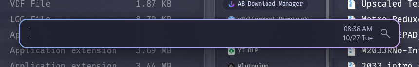

<div align="center">



# Window Ring

**A small Windows 11 app that draws a smooth colored ring around every window.**

The focused window gets your accent color, the rest get a quiet gray, and nothing is injected into other apps.

<a href="https://github.com/DavidHiFi/window-ring/releases/latest">

</a>

<br><br>


</div>

---

## Installation

1. Download `window-ring.zip` from the latest release and unzip it anywhere you like, for example `C:\Tools\window-ring`.
2. Run `window-ring.exe`. Rings appear right away. There is no window or tray icon.
3. To start it with Windows, press `Win+R`, type `shell:startup`, and put a shortcut to `window-ring.exe` in that folder.
4. To quit it, run `window-ring.exe --stop`.

## Features

### Look

- **Accent ring on the focused window:** follows your Windows accent color, with an optional gradient to a second color.
- **Gray ring on every other window:** so you can still see where background windows end.
- **Rounded and anti-aliased:** the ring matches Windows 11's rounded corners instead of drawing a hard box.
- **Fade on focus change:** the colors cross-fade when you switch windows.

### Which windows

- **Every normal window:** anything with a title bar or a sizing frame.
- **Custom-drawn windows too:** launchers and WPF apps like Flow Launcher, using the same "special windows" rule as the Windows 11 Accent Window Border mod.
- **No ring when it would be in the way:** maximized, minimized, fullscreen and hidden windows, menus, tooltips, the desktop and the taskbar are skipped.

### Safety

- **Runs in its own process:** it watches windows through system events and never loads code into other apps, so a hung app can't hang the ring and the ring can't crash an app.
- **Click-through:** rings never take clicks or focus.

## Notes

> [!NOTE]
> **Settings live in `window-ring.ini` next to the exe.** After you edit it, run `window-ring.exe --stop` and start it again.

> [!IMPORTANT]
> **Turn off other border tools first.** If you also run a Windhawk border mod or Tacky Borders, you get two rings on top of each other.

<details>
<summary><b>Settings</b></summary>

<br>

| Key | Default | What it does |
|---|---|---|
| `width` | `2` | Ring thickness in pixels (1 to 32). |
| `gap` | `-1` | Space between the window edge and the ring. Negative pulls it in. |
| `radius` | `16` | Corner radius (0 for square corners). |
| `fadeMs` | `150` | Fade time when focus changes. 0 turns it off. |
| `gradient` | `1` | 1 draws a gradient from the first color to the second. |
| `gradientAngle` | `45` | Gradient direction in degrees. |
| `focused` | `accent` | Focused ring color: `accent` or a hex color like `89b4fa`. |
| `focusedTo` | `cba6f7` | Second gradient color for the focused ring. |
| `unfocused` | `585b70` | Ring color for other windows. |
| `unfocusedTo` | `585b70` | Second gradient color for other windows. |
| `resyncMs` | `500` | How often it double-checks every window, in milliseconds. |
| `exclude` | `windhawk-ui.exe` | Comma-separated list of exe names that never get a ring. |

</details>

<details>
<summary><b>Building from source</b></summary>

<br>

You need a 64-bit MinGW-w64 clang. The one bundled with [Windhawk](https://windhawk.net) works, and the build script uses it when it finds it.

```powershell
./build.ps1                       # uses Windhawk's clang, or clang++ on PATH
./build.ps1 -Compiler C:\llvm-mingw\bin\clang++.exe
```

The exe and the ini land in `bin\`.

</details>

## Contributing

Bug reports with a screenshot of the window that looks wrong help the most. Pull requests are welcome too.

<a href="CONTRIBUTING.md">

</a>

## Star history

Thanks to everyone who starred it.

<a href="https://www.star-history.com/?repos=DavidHiFi%2Fwindow-ring&amp;type=date">
  <picture>
    <source media="(prefers-color-scheme: dark)" srcset="https://api.star-history.com/chart?repos=DavidHiFi/window-ring&amp;type=date&amp;theme=dark&amp;legend=top-left" />
    <source media="(prefers-color-scheme: light)" srcset="https://api.star-history.com/chart?repos=DavidHiFi/window-ring&amp;type=date" />
    
  </picture>
</a>

## Credits

- **Author:** Myself, [DavidHiFi](https://github.com/DavidHiFi)

| Who | What |
|---|---|
| **Guerra24** ([Windows 11 Accent Window Border](https://windhawk.net/mods/win11-accent-border)) | The "special windows" rule for picking which windows get a ring. No code was copied. |
| **lukeyou05** ([Tacky Borders](https://github.com/lukeyou05/tacky-borders)) | The idea of drawing borders from a separate app with click-through overlay windows. No code was copied. |
| **ramensoftware** ([Windhawk](https://github.com/ramensoftware/windhawk)) | The bundled clang toolchain the build script uses. |

Built on the [Win32 API](https://learn.microsoft.com/windows/win32/) and [DWM](https://learn.microsoft.com/windows/win32/dwm/dwm-overview), compiled with [LLVM clang](https://clang.llvm.org/) for [MinGW-w64](https://www.mingw-w64.org/).

> Missing or wrong credit? [Open an issue](https://github.com/DavidHiFi/window-ring/issues/new) and I'll fix it.

## Disclaimers

Most of this project's code was developed with AI coding agents, including Claude Code. No single AI agent made the project.

Window Ring collects nothing and makes no network connections. It only reads window positions and the accent color.

<div align="center">
<br>
<sub>Not affiliated with Microsoft. Requires Windows 11.</sub>
</div>
